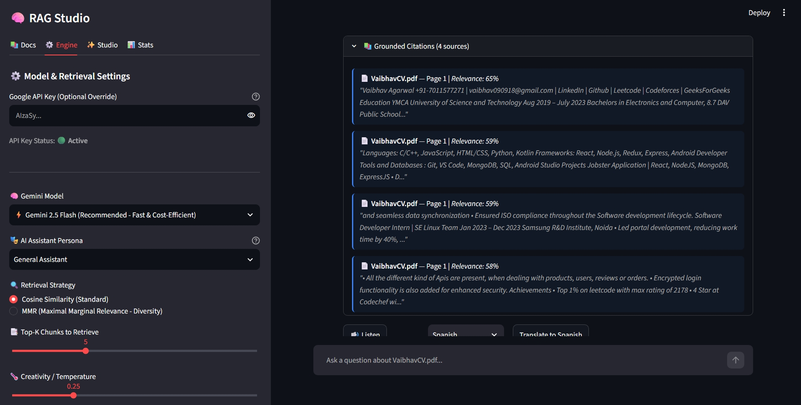
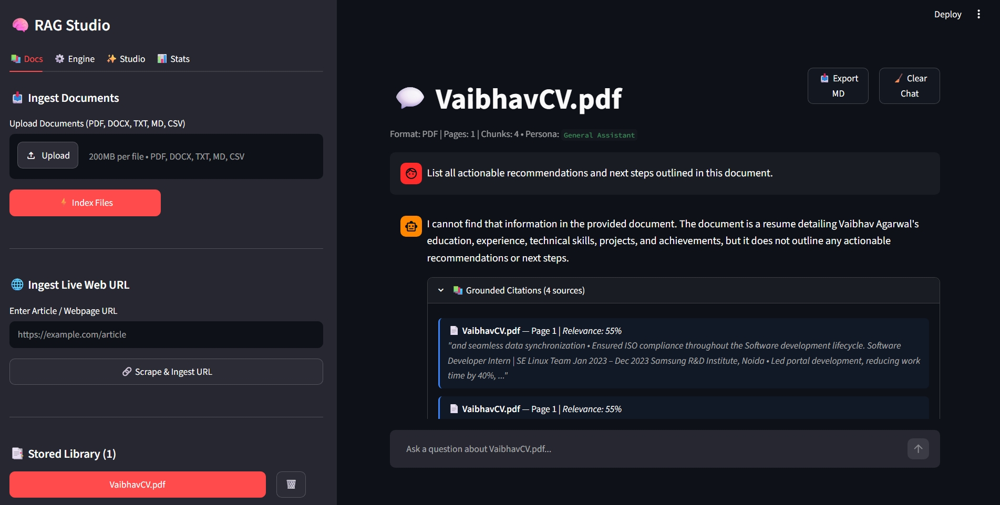
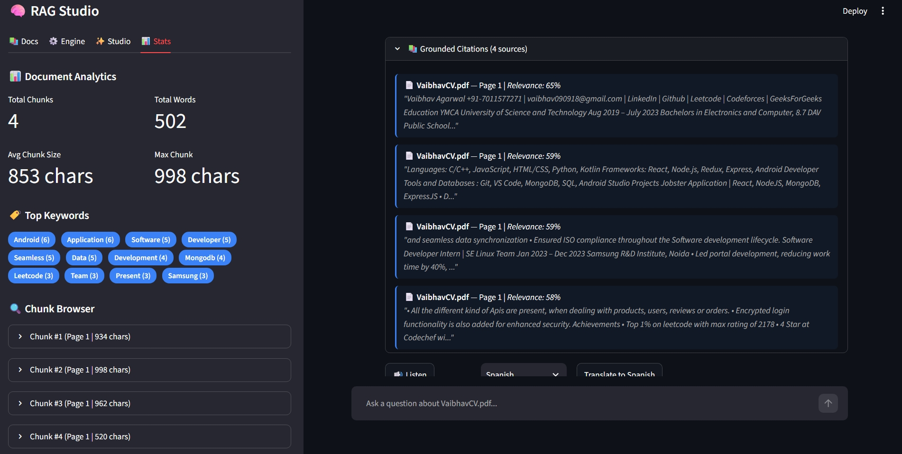

# 🧠 RAG AI Document Studio — Multi-Format RAG & Intelligence Suite

A state-of-the-art **Retrieval-Augmented Generation (RAG)** application that elevates document interaction into an enterprise-grade AI intelligence studio.

Built with **Streamlit**, **LangChain**, **FAISS**, and **Google Gemini 2.5 Flash / Pro**.






---

## 🌟 Amazing & Unique Features

### 1. 📚 Universal Multi-Format & Web Ingestion
- Ingest **PDF** (with page numbers), **DOCX (Word)** (with paragraphs & tables), **TXT**, **Markdown (.md)**, **CSV/Spreadsheets**, and **Live Web URLs** (`http/https`).
- **Batch Upload**: Ingest and index multiple documents simultaneously.
- Automatic metadata extraction: Word count, page estimates, character counts, and preview snippets.

### 2. 🌐 Multi-Document Library & Cross-Document Search
- **Single Document Mode**: Deep-dive conversational QA with any specific document.
- **📚 Library Mode (Global Cross-Doc Search)**: Search and chat across **all uploaded documents simultaneously**, synthesizing insights from multiple sources with unified citations.
- **⚖️ Side-by-Side Document Comparator**: Compare two documents to uncover shared themes, key contrasts, and unique perspectives in a comparative matrix.

### 3. 🎯 Grounded Source Attribution & Citation Cards
- Expandable citation cards under every AI answer.
- Displays exact source filename, page number, relevance percentage score, and context snippets.

### 4. ⚡ Real-Time Streaming & Conversational Memory
- Token-by-token instant streaming responses.
- Context-aware query reformulation that understands follow-up questions (e.g., *"Can you elaborate on the second recommendation?"*).

### 5. ✨ AI Intelligence Studio (One-Click Tools)
- 📋 **Executive Briefing & Key Takeaways**: Auto-generate structured executive summaries with core findings, data points, risks, and strategic next steps.
- ❓ **Smart Auto-Generated FAQs**: Discover top questions the document answers with instant one-click ask buttons.
- 🎯 **Interactive Quiz & Knowledge Tester**: Generate multiple-choice quizzes with instant interactive grading, answer keys, and pedagogical explanations.
- 📊 **Entity & Metrics Extractor**: Extract people, organizations, dates, milestones, and quantitative metrics in clean markdown tables.
- 🌐 **Multi-Lingual Translator**: Instant translation of answers into 14+ languages (Spanish, French, German, Hindi, Japanese, Chinese, Arabic, etc.).

### 6. ⚙️ Hyperparameter Controls & AI Personas
- **Model Selector**: Switch effortlessly between `gemini-2.5-flash`, `gemini-2.5-pro`, `gemini-1.5-flash`, and `gemini-1.5-pro`.
- **Retrieval Modes**: Choose between standard **Cosine Similarity** and **MMR (Maximal Marginal Relevance)** for diverse context coverage.
- **Configurable Parameters**: Top-K retrieval slider (2-12 chunks) and Temperature slider (0.0 - 1.0).
- **AI Personas**:
  - 🎓 *Academic Professor*
  - 💼 *Executive Brief*
  - 🕵️ *Skeptical Fact-Checker*
  - 👶 *ELI5 (Explain Like I'm 5)*
  - 💻 *Technical Specialist*
  - 🤖 *General Assistant*

### 7. 🔊 Audio Voice Narration (TTS) & Rich Exporting
- Listen to AI answers with integrated Text-to-Speech audio playback.
- Export chat conversations to **Markdown (.md)** or **JSON** with one click.

---

## 🛠️ Tech Stack

- **Frontend**: Streamlit (with custom glassmorphic styling & responsive layouts)
- **LLM**: Google Gemini 2.5 Flash / Pro (via `langchain-google-genai`)
- **Embeddings**: Gemini Embedding (`gemini-embedding-001`)
- **Vector Store**: FAISS (CPU) with persistent disk storage
- **Parsers**: PyPDF, python-docx, pandas, BeautifulSoup4
- **Audio TTS**: gTTS (Google Text-to-Speech)
- **Framework**: LangChain + LangChain Classic + LCEL

---

## 📋 Requirements & Installation

```bash
pip install -r requirements.txt
```

### `requirements.txt`
```txt
streamlit
langchain
langchain-community
langchain-google-genai
langchain-classic
faiss-cpu
pypdf
python-docx
gTTS
pandas
beautifulsoup4
requests
python-dotenv
```

---

## 🚀 Setup & Run

1. **Clone the repository**:
   ```bash
   git clone https://github.com/kunalatmosoft/rag.git
   cd rag
   ```

2. **Configure your API Key**:
   Create a `.env` file in the root directory:
   ```env
   GOOGLE_API_KEY=your_google_api_key_here
   ```
   *(Or enter it dynamically in the sidebar under the **⚙️ Engine** tab!)*

3. **Launch the application**:
   ```bash
   python3 -m streamlit run app.py
   # or
   streamlit run app.py
   ```


---

## 📁 Project Structure

```
RAG/
├── app.py                  # Main Streamlit UI with 4 studio tabs & streaming chat
├── rag_pipeline.py         # Advanced RAG engine, multi-doc FAISS, MMR, streaming & personas
├── document_loader.py      # Multi-format document ingestion (PDF, DOCX, TXT, CSV, Web URLs)
├── ai_studio.py            # AI Studio (Summaries, FAQs, Quizzes, Entity Extractor, Comparator, Translator)
├── analytics.py            # Document metrics, keyword frequencies & chunk browser
├── utils.py                # Helpers for file handling, TTS audio, export formatting
├── test_rag_features.py    # Automated test suite
├── .env                    # Environment variables (optional if using sidebar BYOK)
├── requirements.txt
└── README.md
```

---

## 🤝 Contributing

Contributions, issues, and feature requests are welcome!

1. Fork the project
2. Create your feature branch (`git checkout -b feature/amazing-feature`)
3. Commit your changes (`git commit -m 'Add some amazing feature'`)
4. Push to the branch (`git push origin feature/amazing-feature`)
5. Open a Pull Request

---

## 📄 License

This project is open source and available under the [MIT License](LICENCE).

---

**Made with ❤️ using Gemini + LangChain**

